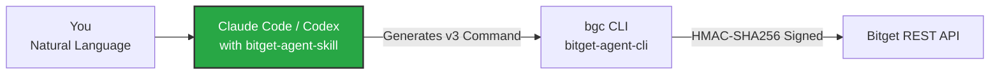

<p align="center">
  
</p>

<h1 align="center">bitget-agent-skill — Official Bitget AI Trading Skill</h1>

<p align="center">
  <strong>Give Claude Code, Codex, and OpenClaw the judgment to understand your trading instructions — when to call Bitget, how to build the right command, and what to do when something goes wrong.</strong>
</p>

<p align="center">
  <a href="https://www.npmjs.com/package/@bitget-ai/bitget-agent-skill"></a>
  <a href="https://www.npmjs.com/package/@bitget-ai/bitget-agent-skill"></a>
  
  <a href="LICENSE"></a>
</p>

<p align="center">
  <a href="#quick-start">Quick Start</a> ·
  <a href="#what-changes-after-installing">What Changes</a> ·
  <a href="#why-a-skill-vs-just-installing-bgc">Why a Skill</a> ·
  <a href="#installation">Installation</a> ·
  <a href="#security">Security</a> ·
  <a href="#troubleshooting">Troubleshooting</a> ·
  <a href="#faq">FAQ</a>
</p>

---

> **Bitget Agent Hub** is Bitget's official open-source AI Agent ecosystem. This repository is `bitget-agent-skill` — the **skill surface** that teaches terminal AI agents when and how to correctly invoke Bitget tools. Ecosystem packages: [agent-skill](https://github.com/Bitget-AI/agent-skill) (this repo), [agent-cli](https://github.com/Bitget-AI/agent-cli), [agent-mcp](https://github.com/Bitget-AI/agent-mcp), [agent-sdk](https://github.com/Bitget-AI/agent-sdk), [bitget-signal](https://github.com/Bitget-AI/bitget-signal), [agent-hub](https://github.com/Bitget-AI/agent-hub).

`@bitget-ai/bitget-agent-skill` is Bitget's official AI trading skill file, giving Claude Code, Codex, and OpenClaw the judgment to use Bitget tools correctly — knowing when to invoke Bitget, how to break your intent into the right multi-step operations, how to handle confirmation before write actions, and what to do when something goes wrong. Pure markdown, runtime-free.

**Is this for you?** You're already using Claude Code, Codex, or OpenClaw and want it to actually understand your trading instructions — not just have the tool but lack the reasoning to use it — install this.

---

## Quick Start

Paste the block below into your AI agent — it will handle the entire setup (requires Node.js 20+):

```prompt
Please help me install the Bitget trading skill (requires Node.js 20+): 1. Run npx @bitget-ai/bitget-agent-skill --target all to deploy the skill files to my AI tool; 2. Run npm install -g @bitget-ai/bitget-agent-cli to install the bgc CLI globally. Tell me the result when done.
```

> Both must be installed together: the skill file is the AI's instruction manual, `bgc` is the execution tool — the skill teaches the AI when to call it and how to build commands, `bgc` actually makes the API requests. Without either one, the full flow is incomplete.

**Verify it worked.** Ask your AI: *"What trading modules does Bitget support?"* If it returns the correct module list (market, trade, account, etc.), the skill is loaded and active.

---

## What Changes After Installing



Without the skill, `bgc` executes one command at a time. With the skill loaded, the AI can chain your intent into a sequence of operations across modules — check positions, evaluate conditions, place the order, handle the result — all in one go.

- **Trigger recognition in English and Chinese**: whether you say "buy BTC at market" or「帮我买 BTC」, the AI recognizes it as a Bitget trading instruction and calls the right tool automatically — no need to specify command syntax
- **v3 grammar and full reference**: the skill file includes the `bgc` v3 grammar (`bgc <tool> --action <name>`) and an auto-generated catalog of all 109 operations — the AI knows which intent verb maps to which operation and how to fill in the parameters
- **Multi-step workflow**: "check my positions, and if I have no BTC open a 10x long" — the AI queries first, reasons, then places the order, showing `[CAUTION]` before every write operation and waiting for your confirmation
- **Paper trading and error handling**: tell the AI "use demo account" to switch to Bitget's sandbox automatically; when API errors occur, the AI knows whether to retry or surface the issue to you — instead of getting stuck

---

## Why a Skill (vs. just installing `bgc`)

The CLI alone gives the AI 16 intent verbs over the Unified Trading Account (109 operations) but no semantics — the assistant doesn't know **when** to reach for Bitget, **which** verb to use, or **how** to drive it safely.

The skill adds:

- A **trigger description** so Claude Code / Codex / OpenClaw automatically invokes the skill on any Bitget-relevant request — including casual phrasings (*"buy 0.1 BTC at market"*) and Chinese (*"查看我的持仓"*).
- The **v3 grammar** (`bgc <tool> --action <name> --<param> <value>`) and a **discover-first** workflow, plus a complete catalog of every verb, action, and parameter auto-generated from the SDK.
- **Operational guidance** for write-safety (`--dry-run` / `--confirm`), close-direction rules, demo trading, error categories, and auth setup.

Result: you say *"buy 0.1 BTC at market on Bitget"* and it actually works — the assistant composes `bgc order --action place --category SPOT --symbol BTCUSDT --side buy --orderType market --qty 0.1`, previews it with `--dry-run`, confirms with you, then runs it.

---

## What Ships in the Skill

| File | Purpose |
|---|---|
| `SKILL.md` | Top-level skill definition with trigger phrases (English + Chinese) so the AI knows when to invoke, plus the v3 grammar, the 16-verb map, and the write-safety workflow. |
| `references/commands.md` | Auto-generated static catalog — every domain, verb, action, and parameter (with enums + descriptions), from the SDK's own `discover` surface. |
| `references/discover-guide.md` | How to navigate the live surface with `bgc discover` (the four rungs, search, `raw`, hidden modules). |
| `references/trading-safety.md` | Close-direction rules (one-way/hedge), TP/SL, `qty` units, cancel-all, and withdrawal safety. |
| `references/auth-setup.md` | How to create a Bitget API key and configure environment variables. |
| `references/demo-trading.md` | How to use `--paper-trading` for safe rehearsal. |
| `references/error-codes.md` | The v3 error payload, category-driven recovery, and the curated Bitget code table. |

---

## Installation

### Step 1: Install the CLI

```bash
npm install -g @bitget-ai/bitget-agent-cli
```

> Why `-g`? `bgc` is a persistent CLI your AI calls dozens of times per session — it must be on `$PATH`. This skill, by contrast, is a one-shot deploy: `npx` copies markdown into your AI tool's skill directory and exits. `npx` always pulls the latest version, so subsequent runs auto-upgrade you.

### Step 2: Deploy the Skill File

```bash
# Default — Claude Code only
npx @bitget-ai/bitget-agent-skill

# All supported AI tools
npx @bitget-ai/bitget-agent-skill --target all

# Choose interactively
npx @bitget-ai/bitget-agent-skill --interactive
```

`--target all` deploys to Claude Code, Codex, and OpenClaw simultaneously.

| Target | Skill location |
|---|---|
| Claude Code | `~/.claude/skills/bitget-agent-skill/` |
| Codex | `~/.codex/skills/bitget-agent-skill/` |
| OpenClaw | `~/.openclaw/skills/bitget-agent-skill/` |

### Step 3: Set Up Credentials

```bash
export BITGET_API_KEY="your-api-key"
export BITGET_SECRET_KEY="your-secret-key"
export BITGET_PASSPHRASE="your-passphrase"
```

[Create an API key](https://www.bitget.com/api-doc/common/intro) if you don't have one. For demo trading, use a [Demo API Key](https://www.bitget.com/account/demo) instead:

```bash
export BITGET_DEMO_API_KEY="your-demo-key"
export BITGET_DEMO_SECRET_KEY="your-demo-secret"
export BITGET_DEMO_PASSPHRASE="your-demo-passphrase"
```

### Step 4: Restart and Verify

Close and reopen your AI tool, then ask: *"What Bitget trading capabilities do you have?"*

---

## Related Tools

| Tool | Relationship |
|---|---|
| [`@bitget-ai/bitget-agent-cli`](https://github.com/Bitget-AI/agent-cli) | Must be installed together: `bgc` is the execution tool, the skill file is the AI's instruction manual — neither works without the other |
| [`@bitget-ai/bitget-agent-mcp`](https://github.com/Bitget-AI/agent-mcp) | Alternative for desktop AI (Claude Desktop, Cursor) — no `bgc` required |
| [`@bitget-ai/bitget-signal`](https://github.com/Bitget-AI/bitget-signal) | Market analysis skills — no API key needed. This skill handles trading execution; `bitget-signal` handles market analysis. Complementary, can be installed side by side |

---

## Security

The skill files themselves:
- No API key required — pure Markdown
- No network access — no runtime process
- No credential storage — keys are passed via environment variables to `bgc`

All actual API calls go through `bgc`, which provides:
- Credentials live only in environment variables (no `.env` file parsing)
- `--read-only` strips all write tools
- `--paper-trading` switches to the demo environment
- Local HMAC-SHA256 request signing

---

## Troubleshooting

### "Skill not recognized by AI"

**Cause:** Skill file not deployed or AI tool not restarted.

**Fix:**
1. Re-deploy: `npx @bitget-ai/bitget-agent-skill --target all`
2. Restart your AI tool completely
3. Verify: ask *"What Bitget trading modules are available?"*

### "AI has bgc but doesn't understand trading commands"

**Cause:** The skill file is missing — `bgc` is installed but the AI has no instruction manual.

**Fix:** Deploy the skill and verify the files landed in the correct location:

| AI Tool | Expected Location |
|---|---|
| Claude Code | `~/.claude/skills/bitget-agent-skill/SKILL.md` |
| Codex | `~/.codex/skills/bitget-agent-skill/SKILL.md` |
| OpenClaw | `~/.openclaw/skills/bitget-agent-skill/SKILL.md` |

### "bgc: command not found"

**Cause:** `bitget-agent-cli` not installed or not on `$PATH`.

**Fix:** `npm install -g @bitget-ai/bitget-agent-cli` then restart your terminal.

---

## Updates

```bash
# Update all Bitget AI packages
npx @bitget-ai/bitget-agent-installer upgrade-all --target all

# Or update just this skill
npx @bitget-ai/bitget-agent-skill@latest
```

---

## FAQ

**Will the AI automatically place orders after the skill is installed?**
No. For write operations like placing orders or transferring funds, the AI displays a `[CAUTION]` annotation and waits for your confirmation before executing.

**How do I trade without real money?**
Tell your AI "use demo account" or "use paper trading" — it will switch to Bitget's Demo Trading environment automatically. Requires a [Demo API Key](https://www.bitget.com/account/demo).

**What's the difference between this and the MCP server?**
Terminal AI (Claude Code, Codex) → install `bitget-agent-skill` + `bgc`. Desktop AI (Claude Desktop, Cursor) → install `bitget-agent-mcp`. Both enable natural language Bitget trading — they adapt to different AI environments.

**Does the skill file require an API key or network access?**
No. Pure Markdown files with no runtime process. All API calls happen at execution time through `bgc`.

**Is it free?**
MIT-licensed and free to use.

---

## Contributing

- **Bug reports & feature requests:** [GitHub Issues](https://github.com/Bitget-AI/agent-skill/issues)
- **Discussions:** [GitHub Discussions](https://github.com/Bitget-AI/agent-skill/discussions)
- **Security concerns:** security@bitget.com

---

## License

[MIT](LICENSE) — Free for personal and commercial use.

---

<sub>Part of the **[Bitget Agent Hub](https://github.com/Bitget-AI/agent-hub)** ecosystem — the official open-source AI Agent ecosystem from Bitget.<br/>
Trading Stack · Skill Surface. ⚠️ Trading cryptocurrency carries risk; you are responsible for any orders your AI agent places. Use demo account to practice safely before trading with real funds.<br/>
Foundation: [agent-sdk](https://github.com/Bitget-AI/agent-sdk) · Execution: [agent-cli](https://github.com/Bitget-AI/agent-cli) · Desktop: [agent-mcp](https://github.com/Bitget-AI/agent-mcp) · Market signals: [bitget-signal](https://github.com/Bitget-AI/bitget-signal)</sub>
